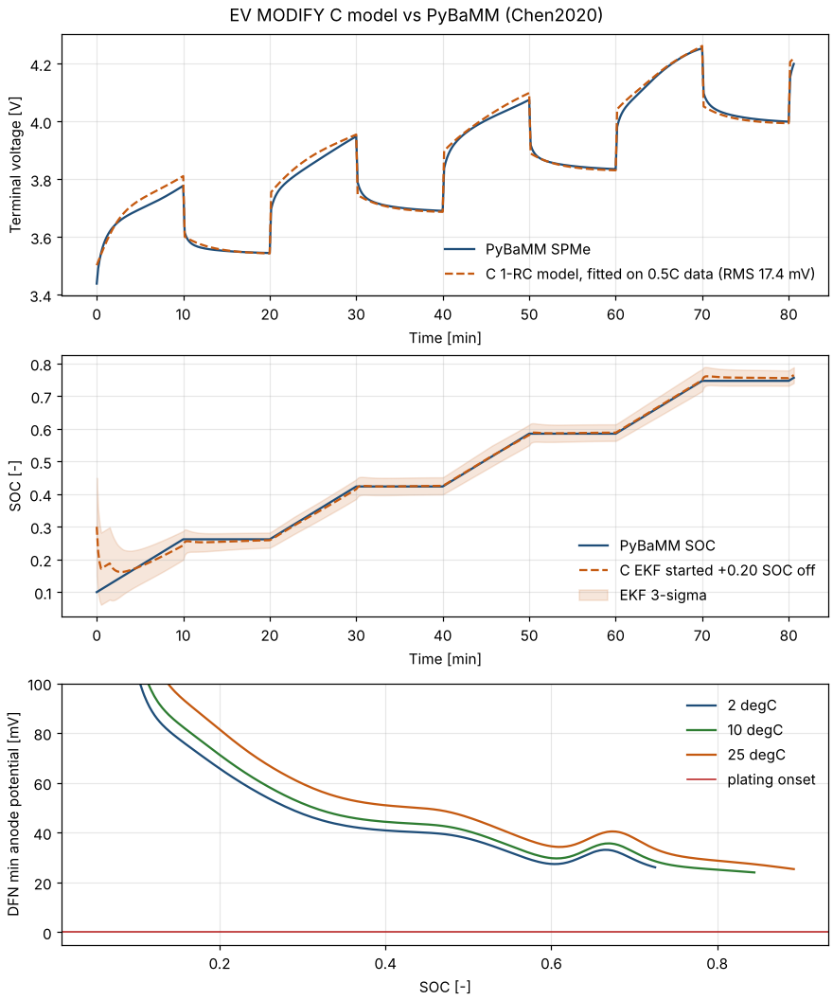

# EV MODIFY

**Copyright (c) 2026 Supreeth S G. All rights reserved.**
**License:** proprietary, see [`LICENSE`](LICENSE). The code may be viewed. Building, running, modifying or any other use requires the author's prior written permission. The build instructions below are for permitted users.

EV MODIFY is a C11 battery-management function that limits the charge current of a series lithium-ion module. The limit is conservative and based on physics. Every control cycle it:

1. validates all inputs and the per-cell configuration;
2. updates each cell's state:
   - a 2-state Extended Kalman Filter tracks SOC and the 1-RC polarisation voltage, with a Joseph-form update, a current-dependent measurement noise and a 5σ innovation gate;
   - a voltage-tracking check that catches a sensor frozen at an in-range value, with or without noise. Over a window, the change of each reading is compared with the change of an open-loop model (coulomb counting, 1-RC and R0, started from the EKF state). Allowances cover 30 % R0, 100 % R1 and 20 % OCV-change errors and the EKF's 3σ SOC band. Above 10 mV of mismatch the EKF stops using the reading. Above 20 mV for 3 cycles the cell faults, and the fault stays latched until the reading is seen to move with the model (for example the R0 step when the current changes);
   - temperature, capacity fade (SOH) and resistance growth are updated alongside it;
3. detects faults, with hysteresis and a 5-cycle hold. This includes a check that the measured current follows the previous approved current, allowing the charger 2 s to ramp down;
4. finds the largest charge current up to the request that keeps **every** cell inside all constraints for max(horizon, control period). The search is a 20-step upward sweep followed by 24 bisection steps.

| Constraint (per cell) | Limit | Flag |
|---|---|---|
| Graphite potential vs Li/Li+ at the end of the horizon (plating margin) | ≥ 5 mV | `EV_CONSTRAINT_ANODE_POTENTIAL` |
| Terminal voltage, bounded over the whole horizon (CV taper) | ≤ 4.2 V | `EV_CONSTRAINT_CELL_VOLTAGE` |
| SOC + 3σ (EKF uncertainty) | ≤ 98 % | `EV_CONSTRAINT_SOC` |
| Predicted cell temperature | ≤ 45 °C | `EV_CONSTRAINT_TEMPERATURE_HIGH` |
| Cell temperature − 2 °C sensor margin while charging (3 °C release hysteresis) | ≥ 0 °C | `EV_CONSTRAINT_TEMPERATURE_LOW` |
| Electrode-averaged electrolyte depletion (keeps c_e ≥ 10 % at the collector) | < 60 % | `EV_CONSTRAINT_ELECTROLYTE_DEPLETION` |

The decision is **ALLOW** (full request), **LIMIT** (a constraint binds; the binding cell and constraint bits are reported) or **FAULT** (0 A, with `EV_FAULT_*` bits). FAULT is returned for:

| Fault | Condition |
|---|---|
| `EV_FAULT_INPUT` | a pack-level input is non-finite or out of range: current beyond ±1000 A, dt outside (0, 10] s, horizon outside (0, 600] s, or a NaN request. Requests above 1000 A are clamped instead. |
| `EV_FAULT_CONFIG` | an `EvCellConfig` field is out of range. |
| `EV_FAULT_VOLTAGE_SENSOR`, `EV_FAULT_TEMPERATURE_SENSOR` | a reading is outside its plausibility window. |
| `EV_FAULT_OVER_VOLTAGE` | measured cell voltage > 4.25 V; releases at 4.20 V. |
| `EV_FAULT_VOLTAGE_PLAUSIBILITY` | 10 consecutive EKF innovations beyond 5σ, or a reading that does not follow the model by more than 20 mV beyond the allowances for 3 cycles (a frozen or stuck sensor). Latched until the reading is seen to track again. |
| `EV_FAULT_OVER_CURRENT` | measured charge current above the allowance for 1 s: the previous approved current, plus a linear 2 s ramp-down after a lower command, plus 5 % + 0.5 A (charger not following the limit). |
| `EV_FAULT_OVER_TEMPERATURE`, `EV_FAULT_UNDER_TEMPERATURE` | cell above 45 °C or below -30 °C; releases 3 °C inside the limit. |
| `EV_FAULT_STATE` | a corrupted estimator state was reset (SOC σ = 0.5). |
| `EV_FAULT_END_OF_LIFE` | SOH has reached 50 %. |

Every fault, including pack-level input faults, is held until 5 consecutive good cycles have passed. When the current or dt measurement is invalid, or a cell's configuration is invalid, the SOC mean is kept and its variance is widened, so uncounted charge can never make the limit optimistic. Positive current means charging.

## Layout

```
src/spme_v7_apex_solver.{h,c}   controller library (public API documented in the header)
tests/test_solver.c             C self-test (129 checks) and demo
tests/test_ocv.py               OCV table / stoichiometry checks
tools/ev_cli.c                  stdin/stdout bridge to the C model (ocv, limit and ekf modes)
tools/ev_model.py               shared Python helpers; parse constants and tables from the C sources
tools/generate_ocv_lut.py       regenerates (or --check) the OCV tables in the C source
tools/calibrate_cell.py         fits thermal + 1-RC parameters to measured data
tools/run_pybamm_sim.py         validation against PyBaMM SPMe and DFN (Chen2020)
docs/                           diagrams and the benchmark plot
.github/workflows/ci.yml        GCC, Clang, ASan/UBSan, MSVC, Cortex-M4F, cppcheck, coverage, PyBaMM
```

## Build and test

Requires CMake ≥ 3.21 and a C11 compiler. The Python checks need Python 3 (validated on 3.13) with `numpy` and `scipy`.

```bash
pip install -r requirements.txt
cmake -S . -B build -DEV_WARNINGS_AS_ERRORS=ON
cmake --build build --config Release
ctest --test-dir build -C Release --output-on-failure
./build/test_solver            # demo: 4 cells, 30 A request, CSV to stdout
```

CTest runs the C self-test, the demo, `tests/test_ocv.py`, the OCV-table freshness check and the calibration self-test. If numpy or scipy is missing, the Python checks are not registered and CMake prints a warning. Options:

- `-DEV_SANITIZE=ON`: AddressSanitizer and UndefinedBehaviorSanitizer (GCC/Clang).
- `-DEV_WARNINGS_AS_ERRORS=ON`: `-Werror` / `/WX`. Off by default; CI turns it on.
- `-DEV_BUILD_TESTS=OFF`: library only. This is the default when the project is used through `add_subdirectory`.
- `-DEV_PYTHON_TESTS=OFF`: skip the Python checks.
- `-DEV_INSTALL=OFF`: no install rules. This is the default under `add_subdirectory`.

The library refuses to compile with `-ffast-math`, `-ffinite-math-only` or `/fp:fast`, because its NaN checks are safety relevant. It is also cross-compiled in CI for a Cortex-M4F (about 14 KB of code). The EKF and SOC accumulation use double precision on purpose, which is software-emulated on single-precision FPUs.

To use it from another CMake project, either embed it:

```cmake
add_subdirectory(EV-MODIFICATION)
target_link_libraries(app PRIVATE ev_modify::ev_modify)
```

or install it (`cmake --install build --prefix <dir>`) and use `find_package(ev_modify 2.0 REQUIRED)`.

## Using the API

```c
#include "spme_v7_apex_solver.h"

EvCellConfig config[EV_NUM_CELLS];   /* capacity, R0, R1, tau (25 degC), thermal parameters, coolant temperature */
EvCellState  state[EV_NUM_CELLS];
for (unsigned i = 0; i < EV_NUM_CELLS; ++i) {
    config[i] = (EvCellConfig){5.0f, 0.041f, 0.0135f, 190.0f, 10.0f, 1100.0f, 25.0f};
    ev_cell_init(&state[i], soc_from_rested_ocv[i], temperature_C[i]);
}
/* every control cycle (dt <= 10 s); current = average over the cycle that just ended: */
EvPackResult r = ev_step(config, state, measured_current_A, requested_current_A,
                         cell_voltage_V, cell_temperature_C, dt_s, 30.0f);
set_charger_current(r.approved_charge_current_A);
```

`ev_cell_max_charge_current()` gives the same limit for a single cell. Every struct field's unit, range and role is documented in `src/spme_v7_apex_solver.h`. The library is single-threaded, allocates no memory and keeps no global state.

## Validation

`tools/run_pybamm_sim.py` (needs `requirements-benchmark.txt`) checks the C code against PyBaMM's Chen2020 LG M50 cell. The CI job runs it on every push.

| Check | Result | Limit |
|---|---|---|
| C OCV table vs PyBaMM bulk OCV (SPMe, 1C pulse profile) | 0.2 mV max | 1 mV |
| 1-RC model fitted on 0.5C pulses (R0 41.3 mΩ, R1 13.5 mΩ, τ 193 s), checked on 1C pulses | 17.4 mV RMS | 25 mV |
| C EKF started 0.20 SOC off; fitted / R0 +20 % / R0 −20 % / capacity −5 % | 1.4 / 2.3 / 1.8 / 1.8 % max SOC error after the first rest | 3 % |
| Same four cases: samples outside the EKF's own 3σ band | 0 % | 1 % |
| Closed loop, C limiter driving a PyBaMM **DFN** (Arrhenius electrolyte and diffusion, 3C request, from 5 % SOC, 2 h), minimum anode potential vs Li/Li+ anywhere in the electrode | +26.1 / +24.0 / +25.4 mV at 2 / 10 / 25 °C | ≥ 0 V |
| Same closed loop: SOC reached in 2 h, so a limiter that never charges cannot pass | 72.5 / 84.5 / 89.2 % | ≥ 65 / 80 / 85 % |



The DFN uses PyBaMM's ideal-solution electrolyte (thermodynamic factor 1), so the controller's measured-electrolyte diffusion-potential factor shows up as extra margin here. The DFN loop feeds the limiter the true SOC, so it validates the plating predictor; the estimator is validated by the EKF rows. The C self-test (129 checks, 98.9 % line coverage of the controller) uses the controller's own model as its plant, including parameter-mismatch and fault-injection cases. PyBaMM is the independent reference. Neither replaces experimental plating validation.

## Model and parameter provenance

- **Electrochemistry (anode).** PyBaMM `Chen2020` (LG M50 21700):
  - stoichiometry windows from `get_min_max_stoichiometries`: OCV 2.5 V at SOC 0 and 4.2 V at SOC 1, with a SOC-window capacity of 5.153 Ah;
  - particle radius, thickness, active fraction, diffusivity and maximum concentration;
  - the exchange-current coefficient and its 35 kJ/mol activation energy.

  The electrolyte values (conductivity, diffusivity, t+) are Nyman2008 at 1 mol/L, with 17 kJ/mol activation energies as in PyBaMM `OKane2022` (Ecker2015). The concentration overpotential uses (1 − t+)(1 + d ln f/d ln c) = 1.85, the upper bound of measured LiPF6 in EC:EMC 3:7 at ≤ 1 mol/L and −10 to 45 °C (Landesfeind & Gasteiger 2019, via PyBaMM `ORegan2022`). Chen2020's ideal-solution value of 0.74 understates the term by 2.1–2.5×. The OCV tables are generated from the Chen2020 OCP functions on a 201-point grid. Interpolation error is ≤ 2.4 mV overall and ≤ 0.2 mV above 10 % SOC.
- **Placeholders without a source.**
  - The 35 kJ/mol activation energy of graphite diffusion.
  - The 17 kJ/mol temperature scaling of R0/R1. These are fitted at 25 °C; characterise the cell at several temperatures to replace it.
  - The ageing model: linear rates (≈2 %/year calendar, ≈20 % after 1000 full equivalent cycles at 25 °C, 30 kJ/mol) and resistance growth of 2.5 × the relative capacity loss.
  - The ageing mode. Capacity fade raises the anode current density by 1/SOH, and the fresh SOC-to-stoichiometry mapping is kept. This is exact only for anode material lost fully lithiated:
    - Loss of lithium inventory, the usual dominant mode, is on the safe side (+2 to +11 mV at 5–20 % loss).
    - Anode material lost partly lithiated is not. For example, 10 % lost at stoichiometry 0.7 / 0.5 / 0.3 (SOH 0.93 / 0.95 / 0.97) puts the anode 11 / 20 / 38 mV below the model.
    - SOH alone cannot bound this, and the OCV table is the fresh cell's. Aged cells need their degradation modes measured (dV/dQ or three-electrode cells).
- **Plating predictor.** A reduced, conservative surrogate:
  - a steady-state polynomial surface-concentration correction;
  - inverted Butler–Volmer kinetics;
  - the full-thickness electrolyte ohmic drop;
  - steady parabolic electrolyte depletion with the exact profile-averaged concentration overpotential, since the depletion time constant is ≈33 s;
  - an SEI film drop equal to the full resistance growth;
  - interfacial current density raised by 1/SOH;
  - concentration gradients (solid surface excess and electrolyte depletion) evaluated at the larger of the new and the previous charge current, because they take tens of seconds to minutes to relax after a step-down;
  - evaluation at the 3σ upper SOC, and at the colder of the present temperature and the zero-current prediction, minus the 2 °C sensor margin. No credit is taken for Joule self-heating, so every constraint is monotone in current and the approved current never falls when the request rises.

  With the example parameters it allows ≈0.66C at 25 °C and 50 % SOC, ≈0.37C at 90 % SOC, and ≈0.35C at 5 °C and 50 % SOC.
- **Thermal model.** Lumped. Mass 69 g, cooling area 5.31 cm² (PyBaMM's 21700 value). Heat source I²(R0 + R1) at the cell temperature.

## Limits of the evidence

This is research software, not a qualified product. Use on a vehicle requires at minimum:

1. cell-specific calibration of the OCV, 1-RC (at several temperatures), thermal and ageing parameters (`tools/calibrate_cell.py`);
2. experimental plating validation (for example three-electrode cells or post-mortem analysis);
3. HIL, fault-injection and timing tests on the target MCU;
4. requirements traceability and an ISO 26262 safety case.

The diagrams in `docs/diagrams/` summarise the architecture, the model scope and the validation roadmap.
